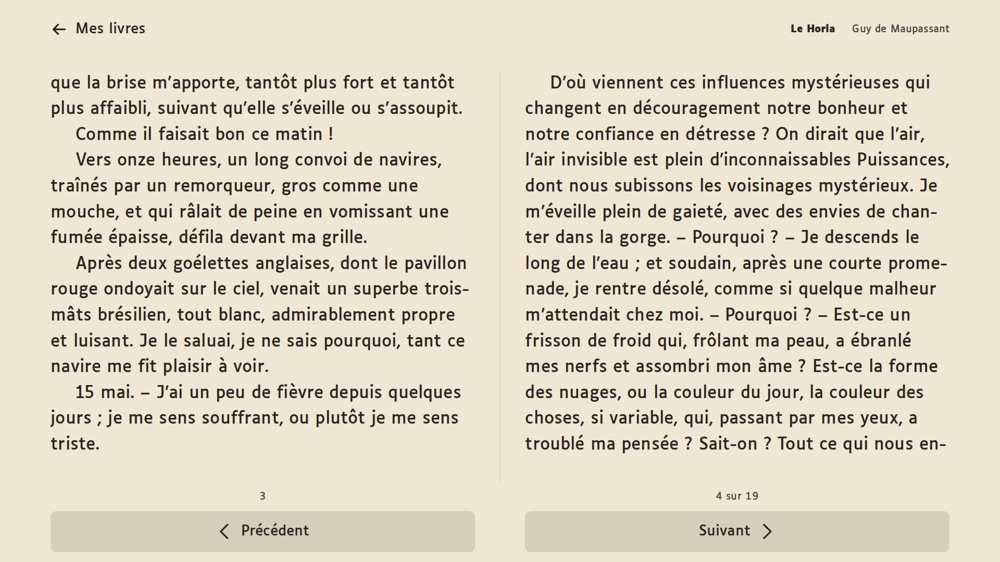
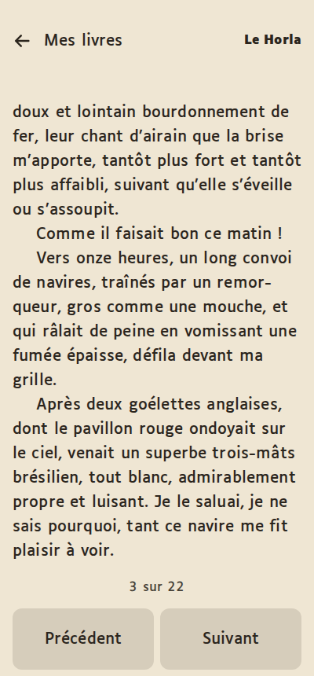
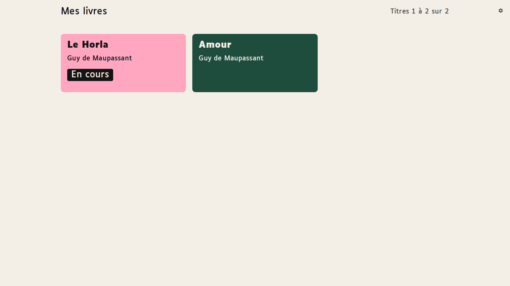
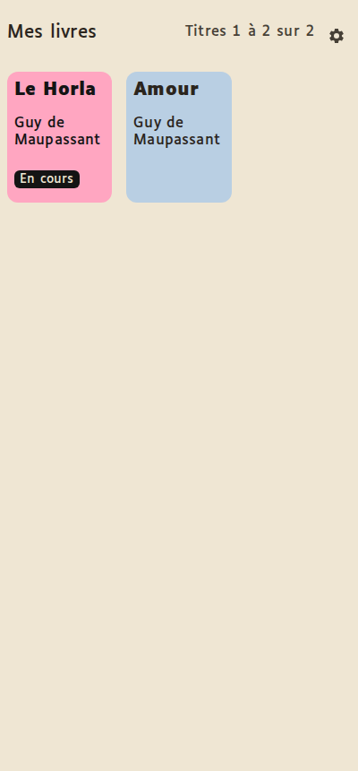
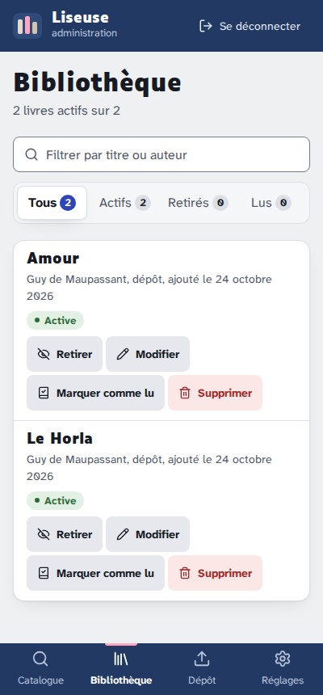
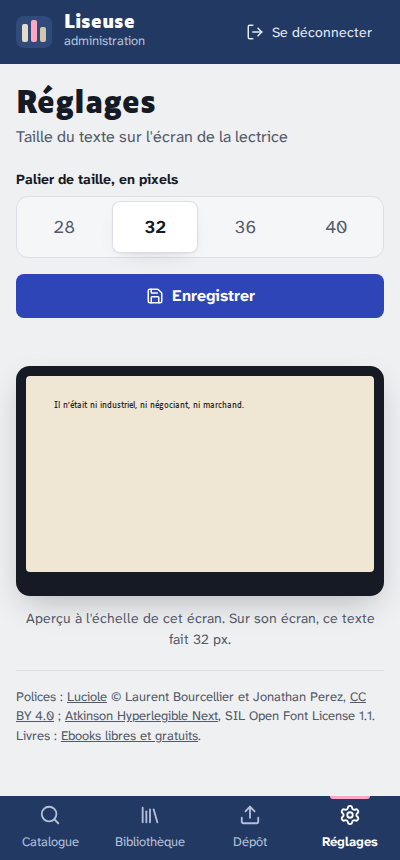
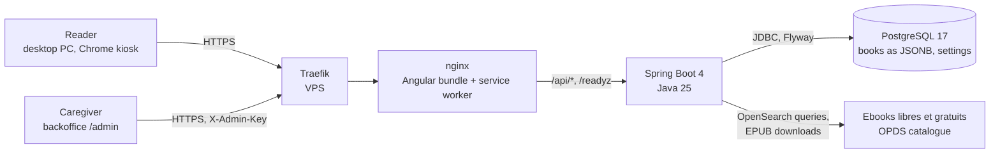

# Liseuse

[](https://github.com/ThomasHtn/book-reader/actions/workflows/deliver.yml)
[](https://github.com/ThomasHtn/book-reader/actions/workflows/codeql.yml)

A web book reader built for a single person: an elderly relative with early age-related macular
degeneration (AMD), who can no longer read large print even with a magnifier and does not use
computers. She clicks the desktop icon, finds her page and reads. A backoffice lets her caregiver
choose the books and adjust the display remotely, from a phone.

Instance: [book-reader.thomashtn.dev](https://book-reader.thomashtn.dev) (not indexed).



## Three commands, nothing else

| Command | Mouse | Keyboard |
|---|---|---|
| Next page | "Suivant" bar, under the right page | right arrow or space |
| Previous page | "Précédent" bar, under the left page | left arrow |
| My books | "Mes livres" button, top left | Tab then Enter |

No menu, no message, no confirmation. AMD degrades central vision and spares the periphery: the text
fills the screen as two facing pages, like an open book, in regular weight and lines of about forty
characters, so the eye is not sent back to the margin every three words; the page turns are
wide, calm tone-on-tone bars, each under the page it turns, and a bar that leads nowhere (first or
last page) disappears. A command received less than 400 ms after the previous one
is ignored, and so is the repeat of a held key. The position is saved on every page; at startup, the
last book resumes.

"Mes livres" (my books) shows up to nine books, three per row, each on a soft colour of its own so
she recognises it before reading its title, with an icon of its state (closed book, open book, tick);
the book in progress is pink. A discreet gear at the top right leads to the
backoffice, meant for the caregiver.

The interface is in French, the reader's language.

## Screenshots

| Reading (1920 px) | Reading (400 px) |
|---|---|
|  |  |

| My books (1920 px) | My books (400 px) |
|---|---|
|  |  |

| Backoffice, catalogue (400 px) | Backoffice, library (400 px) | Backoffice, settings (400 px) |
|---|---|---|
|  |  |  |

The catalogue search shown is served by the test, which intercepts it: the screenshots never contact
the catalogue site.

Generated by `SCREENSHOTS=1 npx playwright test e2e/screenshots.e2e.ts` (from `frontend/`, after
`make reset up`) on Maupassant's *Le Horla*
and *Amour* (public domain), at size tier 32.

## Architecture



- **Server-side conversion**: an EPUB (from the catalogue or uploaded) becomes a flat list of
  plain-text blocks, heading or paragraph; the reader only ever displays text nodes.
- **Per-chapter pagination in CSS columns**: a page is one column exactly as wide as the text area.
  The whole book in a single container exceeded Blink's layout ceiling and took more than a second
  on a modest PC ([spike](docs/specification.md#52-pagination)).
- **Position independent of the display**: (block index, character offset), resolved with `Range`,
  stored in `localStorage`.
- **"Page 12 of 840" without laying everything out**: only the displayed chapter goes through the
  browser; the others are estimated by a pure computation (character widths, line breaking, column
  filling) within 2 % of the real count, then replaced by their exact count once displayed.
- **Global, server-driven settings**: size tier (28, 32, 36, 40 px), polled every ten seconds with
  an ETag, applied without losing the page.

## Development

Requirements: Java 25, Node 22, Docker. `make` lists every command.

```bash
make setup   # first run: backend/.env with the demo admin key, frontend dependencies
make dev     # PostgreSQL on :5433, API on :8080, app on :4200 (/api proxied)
```

## Tests

| Command | Content |
|---|---|
| `make verify` | Every CI gate. Backend: Spotless, Checkstyle, JUnit on PostgreSQL Testcontainers, ArchUnit, SpotBugs, JaCoCo (90 % lines, 70 % branches). Frontend: Prettier, ESLint, stylelint, Vitest with coverage floors, production build |
| `make reset up` then `make e2e` | Playwright: the full journey with axe-core on every screen, against the Docker images on :8000 |

`make fix` applies the formatters. The [contributing guide](CONTRIBUTING.md) describes the code map,
the conventions and these tools.

The converter is tested on versioned EPUB fixtures reproducing the three generators found in the
catalogue; the OPDS client is tested against a fake server fed with recorded responses, never against
the real site.

## Deployment

Every push to `main` that passes the tests, the image scan and the browser journey publishes two images
on GHCR, `book-reader-backend` and `book-reader-frontend`, tagged `sha-<commit>`. The server only pulls
them: nginx is the single entry point and relays `/api` to the backend. What a server must provide is
described in [docs/deployment.md](docs/deployment.md); `compose.yaml` runs the same images locally.

Setting up the reader's PC (Chrome kiosk shortcut, automatic session) is described in
[section 16 of the specification](docs/specification.md#16-installation-du-poste).

## Documentation

- [Contributing guide](CONTRIBUTING.md): code map, conventions, quality tools, recipes.
- [Specification](docs/specification.md) (in French): journey, pagination, API, schema, decisions.
- [Design system](docs/design-system.md) (in French), with [its tokens](docs/design-system/tokens.css) and
  [the preview](docs/design-system/preview.html).

## Credits

- **Luciole** typeface © Laurent Bourcellier and Jonathan Perez, [luciole-vision.com](https://www.luciole-vision.com/),
  under the [Creative Commons Attribution 4.0](https://creativecommons.org/licenses/by/4.0/) licence.
- **Atkinson Hyperlegible Next** typeface © The Atkinson Hyperlegible Next Project Authors, under the
  [SIL Open Font License 1.1](frontend/public/fonts/atkinson-hyperlegible-next/OFL.txt).
- Books: [Ebooks libres et gratuits](https://www.ebooksgratuits.com/) catalogue, public-domain texts
  typeset by its volunteers.
