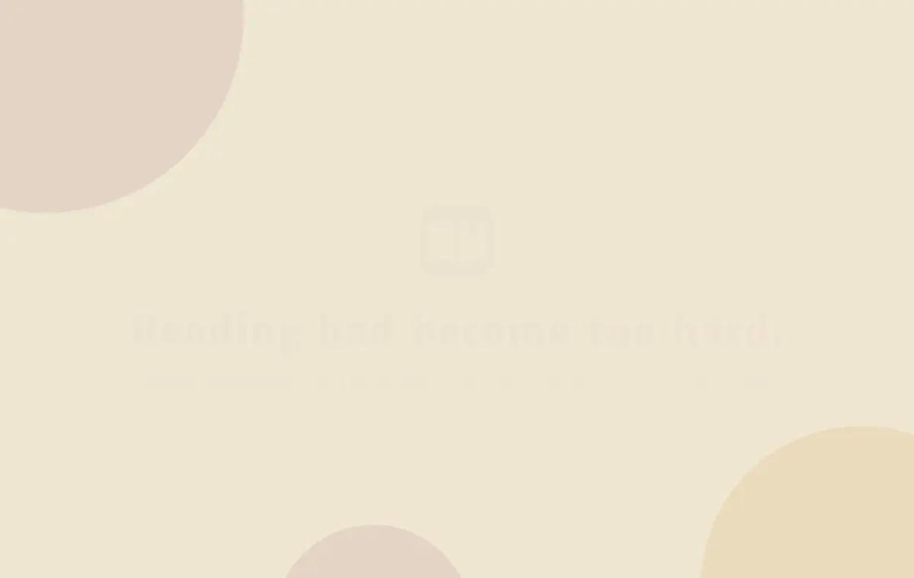
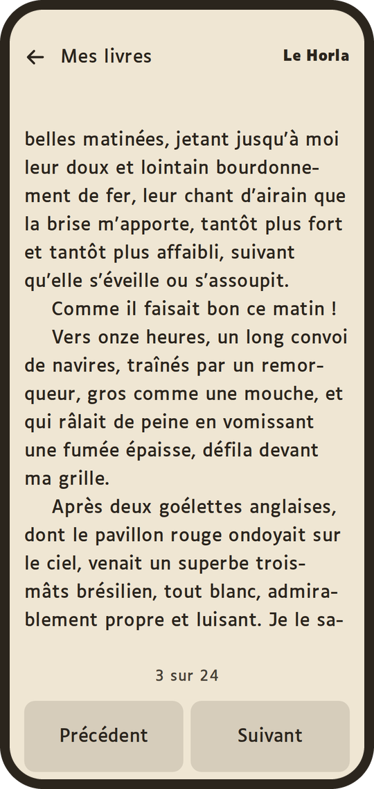
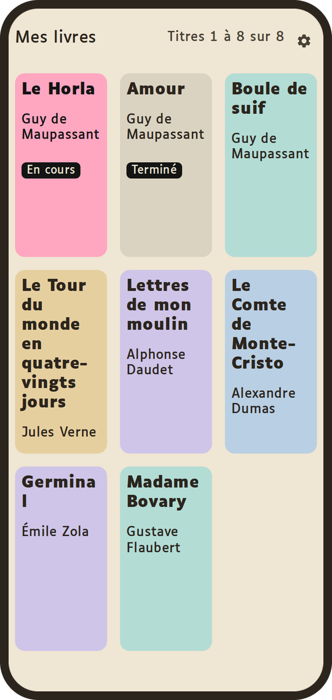
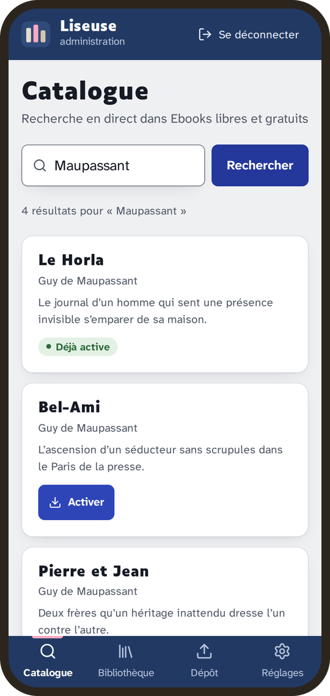
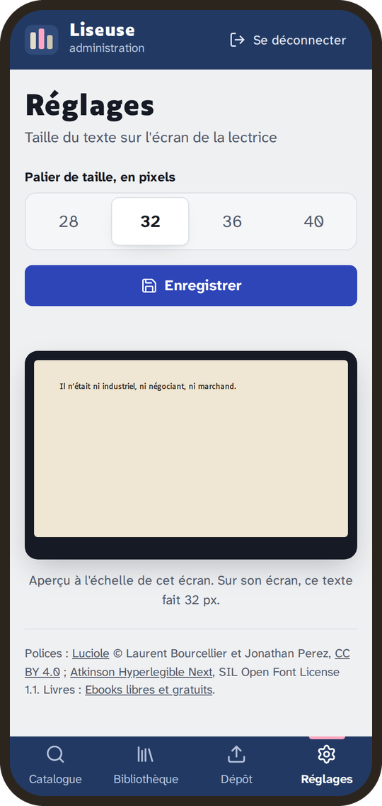
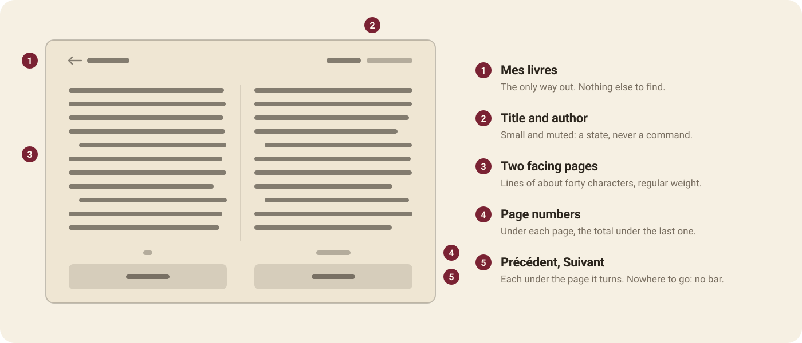
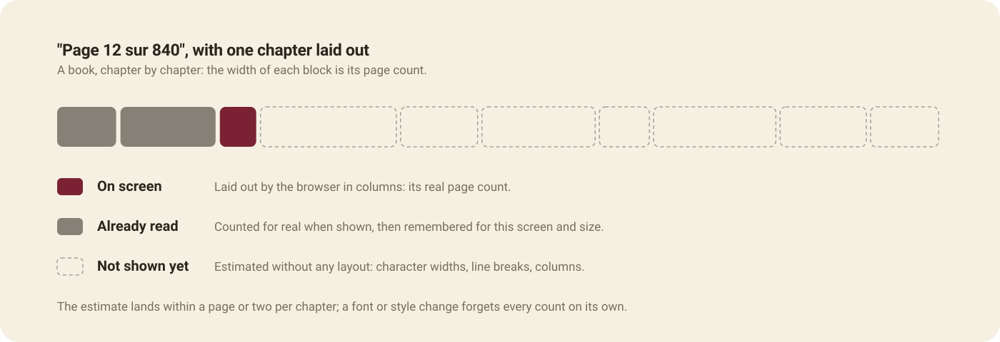
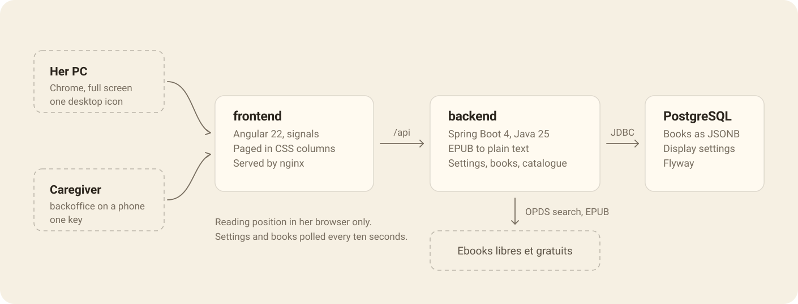

<p align="center">
  
</p>

<h1 align="center">Liseuse</h1>

<p align="center">
  <b>A book reader for eyes that are giving up.</b><br>
  Two calm pages, three commands, and her place kept forever.<br>
  Built for one reader with macular degeneration, set up from afar by the one who looks after her.
</p>

<p align="center">
  
  
  
  
</p>

<p align="center">
  
  <br>
  <sub>A 45-second tour. Public-domain books, real app.</sub>
</p>

## Reading had become too hard

Macular degeneration eats the middle of what you look at. The edges stay sharp, the word you aim
at blurs. Large-print books are not large enough, a magnifier shows four words at a time, and
tablets are full of things to swipe, tap by mistake and get lost in.

So she stopped reading.

**Liseuse gives her the books back.** She clicks one icon on her computer and her book opens where
she left it, in letters about three times the size of a paperback's, with nothing else on the screen.

## A peek inside

<p align="center">
  
  
  
  
  <br>
  <sub><b>Reading</b> · <b>Her&nbsp;books</b> · <b>Catalogue</b> · <b>Text&nbsp;size</b></sub>
</p>

## One screen, five things



Her screen shows two facing pages, like an open book, in umber ink on cream paper. Lines stay
around forty characters so her eyes never travel far, in Luciole, a typeface drawn for low vision,
in regular weight. The page turns are wide, quiet bars under the page they turn, and a bar that
leads nowhere is simply not there. No menu, no message, no confirmation: nothing she could open by
mistake.

## "Page 12 sur 840", without laying out 840 pages



She wants to know how far she is. Laying out a whole novel in the browser takes seconds on a modest
PC, so only the chapter on screen is laid out. Chapters she has read keep their real count, and the
others are estimated from character widths and line breaks, then replaced once she gets there.

## Why it works for her

<table>
  <tr>
    <td width="50%" valign="top">
      <br>
      <b>An open book, not an app</b><br>
      Two pages side by side, numbered underneath, a soft fold between them. Large enough for her
      eyes, calm enough for an afternoon.
    </td>
    <td width="50%" valign="top">
      <br>
      <b>Three commands, nothing else</b><br>
      Précédent, Suivant, Mes livres. The arrow keys and the space bar turn pages too, and a
      double click or a held key never skips one.
    </td>
  </tr>
  <tr>
    <td width="50%" valign="top">
      <br>
      <b>Never loses her page</b><br>
      Every page turn is saved. The computer can be switched off mid-sentence: the next click on the
      icon opens the same page.
    </td>
    <td width="50%" valign="top">
      <br>
      <b>Set up from afar</b><br>
      The caregiver picks the text size from a phone, during a call. Her screen follows within ten
      seconds, at the same sentence.
    </td>
  </tr>
  <tr>
    <td width="50%" valign="top">
      <br>
      <b>Thousands of free classics</b><br>
      Maupassant, Hugo, Zola, Verne: search the Ebooks libres et gratuits catalogue and put a book
      on her shelf in one tap, or drop in an EPUB of your own.
    </td>
    <td width="50%" valign="top">
      <br>
      <b>It is yours</b><br>
      Your server, one backoffice key, no account for her. Her reading position stays in her
      browser. No tracker, no advertising, nothing sent anywhere.
    </td>
  </tr>
</table>

## A typical afternoon

|           |                                                                                    |
| --------- | ---------------------------------------------------------------------------------- |
| **14:00** | She clicks the icon on her desktop. *Le Horla* opens at the page she left yesterday. |
| **14:01** | The right arrow, or the Suivant bar: two new pages. Nothing else moves.            |
| **15:20** | On the phone she says the letters look small. The caregiver taps 36 in the backoffice. |
| **15:21** | Her page grows, at the same sentence. She did not touch anything.                  |
| **16:45** | "Fin du livre". In Mes livres it carries a tick, and the next book is waiting.     |

## Where the books come from

[Ebooks libres et gratuits](https://www.ebooksgratuits.com/), a library of public-domain French
texts typeset by volunteers. The backoffice searches its catalogue live and imports a book in one
tap; an EPUB of your own can be uploaded too. Either way the server turns it into plain text once,
so her reader only ever shows words: no DRM, no images to decode, no formatting to trip over.

## Get it

You bring the books, Liseuse brings the rest.

**Try it** in one command, nothing to configure:

```bash
docker compose up --build    # or: make up
```

Then open http://localhost:8000. The shelf starts empty: open the backoffice from the gear at the
top right, sign in with `book-reader-demo-admin-key-0123456789`, and add a book from the catalogue
or an EPUB.

**Host it** for yourself: two Docker images (web and API, amd64) and a PostgreSQL database. Your
server writes its own compose from the contract in [docs/deployment.md](docs/deployment.md); setting
up her PC (Chrome in kiosk mode behind one desktop icon) is in
[section 16 of the specification](docs/specification.md#16-installation-du-poste).

**Hack on it**: `make setup && make dev`, then [CONTRIBUTING.md](CONTRIBUTING.md).

The interface is in French, her language.

## Under the hood

<details>
<summary>Stack, quality and supply chain</summary>
<br>



- **Frontend**: Angular 22 (standalone, zoneless, signals, `httpResource`), Tailwind 4 for layout and SCSS on design tokens for the rest, self-hosted Luciole and Atkinson Hyperlegible Next, served by nginx with a service worker for the app shell.
- **Pagination**: one chapter at a time in CSS columns, positions as (block, character) resolved with `Range`, page counts estimated by a pure function and remembered once measured.
- **Backend**: Spring Boot 4 on Java 25, PostgreSQL 17 with Flyway, EPUB conversion with guards on size, entries and nesting, an OPDS client that never leaves the catalogue host.
- **Auth**: the reader side is public and read-only; the backoffice takes one key, with a per-address lockout.
- **Quality**: a comment on every declaration, ESLint, Stylelint, Prettier, Checkstyle, Spotless, SpotBugs, ArchUnit layering, JUnit on Testcontainers with JaCoCo floors, Vitest with coverage floors, and a Playwright journey with axe-core against the images.
- **Supply chain**: every push to `main` is tested, scanned with Grype and driven in a browser before its images are published on GHCR; Dependabot and CodeQL watch the rest.

[](https://github.com/ThomasHtn/book-reader/actions/workflows/deliver.yml)
[](https://github.com/ThomasHtn/book-reader/actions/workflows/codeql.yml)

</details>

- [CONTRIBUTING.md](CONTRIBUTING.md): setup, code map, conventions. Start here.
- [docs/specification.md](docs/specification.md) (in French): journey, pagination, API, schema, decisions.
- [docs/design-system.md](docs/design-system.md) (in French): the reader's visual rules, with [its tokens](docs/design-system/tokens.css).
- [docs/deployment.md](docs/deployment.md): images, routing, variables.
- [tools/tour/README.md](tools/tour/README.md): how the tour and the screens above are recorded.

## Credits

- **Luciole** typeface © Laurent Bourcellier and Jonathan Perez, [luciole-vision.com](https://www.luciole-vision.com/),
  under the [Creative Commons Attribution 4.0](https://creativecommons.org/licenses/by/4.0/) licence.
- **Atkinson Hyperlegible Next** typeface © The Atkinson Hyperlegible Next Project Authors, under the
  [SIL Open Font License 1.1](frontend/public/fonts/atkinson-hyperlegible-next/OFL.txt).
- **Lucide** icons, under the [ISC licence](https://lucide.dev/license), in the app and above.
- Books: the [Ebooks libres et gratuits](https://www.ebooksgratuits.com/) catalogue, public-domain
  texts typeset by its volunteers.
